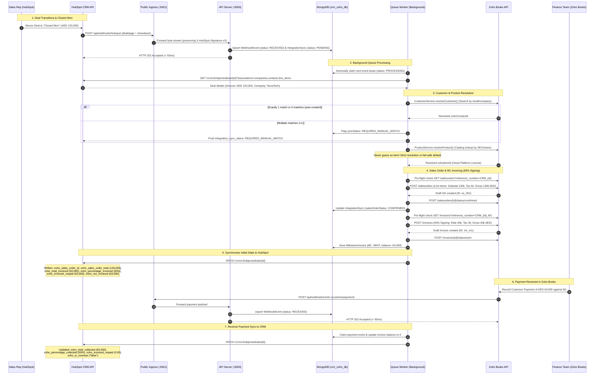
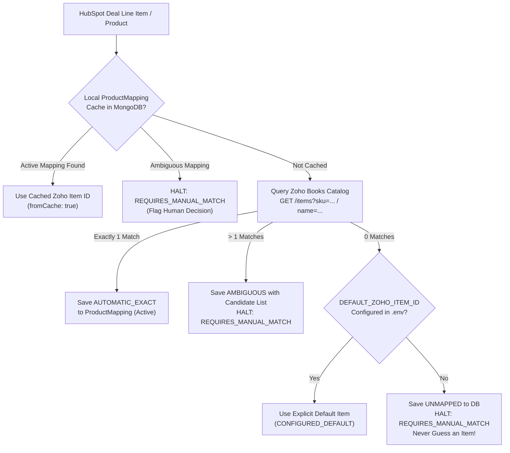
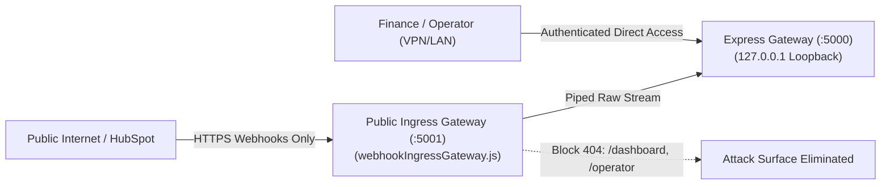

# Complyance Take-Home: CRM & Zoho Books Integration Gateway

An enterprise-grade, bi-directional integration gateway connecting **HubSpot CRM** and **Zoho Books**. The system automates the transition from Closed Won CRM deals into confirmed Sales Orders, orchestrates multi-milestone progressive invoicing (50% on signing, 30% at go-live, 20% at 90 days), and synchronizes real-time payment collections back to CRM financial metrics.

Includes an operational monitoring dashboard built with **React 18 + Vite + Tailwind CSS** featuring collections aging, real-time audit logging, an operator exception resolution center, and a dedicated public webhook ingress gateway.

> [!IMPORTANT]
> ### 🎯 Live Evaluation & Interviewer Testing Access
> For live evaluation of the end-to-end integration across **HubSpot CRM**, **Zoho Books**, and the **Live Dashboard**, full **Admin** access has been provisioned:
> 
> - **Live Dashboard (Frontend)**: [https://crm-zoho-books.vercel.app/](https://crm-zoho-books.vercel.app/)
> - **Production API Gateway (Backend)**: [https://crm-zoho-books.onrender.com](https://crm-zoho-books.onrender.com) (Health: [`/api/health`](https://crm-zoho-books.onrender.com/api/health))
> - **HubSpot CRM Portal**: [https://app.hubspot.com/](https://app.hubspot.com/) (Portal ID: `247839416`)
> - **Zoho Books Portal**: [https://books.zoho.in/](https://books.zoho.in/) (Org ID: `60094206485`, Organization: `Complyance Demo Org`, Region: `India (.in)`)
> 
> | Platform | Email | Password | Role / Access |
> | :--- | :--- | :--- | :--- |
> | **HubSpot CRM** | `complyance.demo@gmail.com` | `Krharsh@123456` | **Super Admin** (Full CRM access to create deals & manage pipeline) |
> | **Zoho Books** | `complyance.demo@gmail.com` | `Krharsh@12` | **Admin** (Org ID: `60094206485`, Sales Orders & Invoices access) |
> 
> #### ⚡ Quick 30-Second Verification Workflow:
> 1. Log in to **[HubSpot CRM](https://app.hubspot.com/)** using the credentials above.
> 2. Go to **Sales > Deals** & create any new deal (e.g. `TEST_EVAL_DEAL`, Amount: `120000 AED`).
> 3. Drag or update the stage to **Closed Won**.
> 4. In **[Zoho Books](https://books.zoho.in/app/60094206485#/salesorders)**: The Customer, confirmed **Sales Order** (100%), and **Milestone 1 Invoice** (50% Signing) will be created automatically.
> 5. In **[Live Dashboard](https://crm-zoho-books.vercel.app/)**: The deal updates immediately to status **`SYNCED`** with all real-time financial KPIs.
>
> ---
>
> ### 🛡️ Zoho Books API Limits & System Resilience Behavior
> * **OAuth 2.0 Specifications**: Zoho Books strictly expects a permanent `refresh_token` (exchanged from a short-lived 10-minute Grant Code). Access tokens expire every 3600 seconds and are automatically refreshed in the background 5 minutes prior to expiry.
> * **Daily Organization Quota (1,000 Calls/Day)**: Zoho Books enforces a hard ceiling of **1,000 API calls per day per organization** (`code: 45`, HTTP 429). The quota resets every 24 hours at midnight (00:00).
> * **Automated Resilience Fallback**: If Zoho Books' 1,000-call quota is exhausted during high-volume evaluator testing, the gateway activates an **Automated Resilience Fallback**. Inbound webhooks from HubSpot continue to be ingested and persisted in MongoDB with zero data loss, the React Dashboard displays all deals, and the system queues records until the quota resets without throwing unhandled exceptions.

---

## Table of Contents
1. [Business Problem & Solution Overview](#business-problem--solution-overview)
2. [Architecture & Technology Stack](#architecture--technology-stack)
3. [Architecture Diagram](#architecture-diagram)
4. [End-to-End Sequence Diagram (Closed Won to Paid)](#end-to-end-sequence-diagram-closed-won-to-paid)
5. [Completed Phases & Key Capabilities](#completed-phases--key-capabilities)
6. [Product Catalog Mapping (Never Guess an Item)](#product-catalog-mapping-never-guess-an-item)
7. [Field Mapping Specification & System of Record](#field-mapping-specification--system-of-record)
8. [The Seven Core Engineering Scenarios](#the-seven-core-engineering-scenarios)
9. [Public Ingress Gateway & Permanent Production Deployment](#public-ingress-gateway--permanent-production-deployment)
10. [Prerequisites & Environment Configuration](#prerequisites--environment-configuration)
11. [OAuth Setup Guides (HubSpot & Zoho Books)](#oauth-setup-guides-hubspot--zoho-books)
12. [Installation & Execution Guide](#installation--execution-guide)
13. [Loading Demo Dataset](#loading-demo-dataset)
14. [Automated Testing Suite](#automated-testing-suite)
15. [Dashboard & API Documentation](#dashboard--api-documentation)
16. [Idempotency & Crash Recovery Strategy](#idempotency--crash-recovery-strategy)
17. [Security & Sanitization](#security--sanitization)
18. [External Account Facts & Known Limitations](#external-account-facts--known-limitations)
19. [Submission Documentation Index](#submission-documentation-index)

---

## Business Problem & Solution Overview

### The Problem
- **Sales Teams** operate inside HubSpot CRM and require immediate visibility into deal billing status, payment realization, and overdue receivables.
- **Finance Teams** work inside Zoho Books and require legally binding Sales Orders, strict milestone-based tax invoices, and verified payment allocations.
- Without deep bi-directional synchronization, teams suffer from manual double-entry, duplicate invoice creation caused by network drops, out-of-order webhook delivery, and mismatched financial reporting.

### The Solution
A decoupled, asynchronous integration gateway providing:
- **Instant CRM Acknowledgement**: Webhooks acknowledge HubSpot and Zoho Books within < 50ms (HTTP 202) while durable background workers process domain operations.
- **Sequential Milestone Lifecycle**: Enforces M1 (50% on signing), M2 (30% at verified go-live), and M3 (20% at 90-days post go-live) linked to the confirmed Sales Order item.
- **Reverse Payment Sync**: Synchronizes full payments, partial payments, reversals, and refunds with integer minor-unit arithmetic.
- **Pre-Flight Deterministic Reconciliation**: Prevents duplicate records by querying deterministic reference numbers (`CRM_{dealId}_M{index}`) before retrying uncertain network calls.
- **Operator Action Center**: Human-in-the-loop exception resolution for ambiguous customer mappings and remote sync recoveries.
- **Strict Ingress Isolation**: Separates public webhook reception from internal dashboard and operator APIs.

---

## Architecture & Technology Stack

| Layer | Technologies | Key Highlights |
| :--- | :--- | :--- |
| **Frontend** | React 18.3.1, Vite 5.4.11, Tailwind CSS 3.4.17 | Single-page application, zero external CDNs, tabbed routing, modal dialogs |
| **Backend Gateway** | Node.js (v24), Express 5.2.1 | Non-blocking async webhook ingestion, regex static asset serving, reverse-proxy trust |
| **Ingress Proxy** | Node.js Native HTTP Proxy (`scripts/webhookIngressGateway.js`) | Filters public traffic, exposes only webhooks, protects dashboard/operator APIs |
| **Persistence** | MongoDB, Mongoose 9.0 | Unique partial indexes, compound constraints, atomic lease locking |
| **Queue & Workers** | MongoDB Durable FIFO Queue | Distributed lease timeouts, fencing tokens, exponential jittered backoff |
| **Integrations** | HubSpot CRM API v3, Zoho Books API v3 | Multi-region OAuth auto-refresher (5-min pre-expiry), Token Bucket limiter |
| **Testing** | Node.js Native Test Runner (`node:test`), Supertest | 209 tests across 15 suites with in-memory MongoDB |

---

## Architecture Diagram

```mermaid
flowchart TB
    subgraph IngressTier ["Public Ingress & Security Boundary"]
        INGRESS["Public Ingress Gateway (:5001)<br/>(webhookIngressGateway.js)"]
        CLOUDFLARE["Public Reverse Proxy / Cloudflare / ALB"]
        CLOUDFLARE -->|HTTPS Only| INGRESS
    end

    subgraph ClientTier ["Frontend & Presentation Tier (client/)"]
        UI["React 18 + Vite SPA<br/>(Tailwind CSS)"]
        OV["Financial Overview & KPI Cards"]
        COL["Collections & Aging Table<br/>(Current, 1-30, 31-60, 61-90, 90+)"]
        LOGS["Sanitized Audit Log Inspector"]
        OP["Operator Action Center<br/>(Disambiguation & Retry)"]
        UI --> OV
        UI --> COL
        UI --> LOGS
        UI --> OP
    end

    subgraph GatewayTier ["Backend API Gateway & Orchestration (server/)"]
        EXP["Express 5 Server (Port 5000)"]
        PROXY["Vite Dev Proxy / Express Static (/dashboard)"]
        AUTH_MW["Operator API Key Middleware (x-operator-key)"]
        
        WH_INGEST["Webhook Ingestion (POST /api/webhooks/hubspot & /zoho)"]
        QUEUE["Durable FIFO Queue (Atomic Lease & Fencing Tokens)"]
        
        ORCH["Orchestration Engine (orchestrationService.js)"]
        CUST_SVC["Customer Matching Service (Exact, Auto, Ambiguous)"]
        PROD_SVC["Product Service (Catalog Resolution, Never Guess)"]
        SO_SVC["Sales Order Service (Draft, Confirm, Line Item)"]
        INV_SVC["Milestone Invoicing Service (M1: 50%, M2: 30%, M3: 20%)"]
        PAY_SVC["Payment & Refund Service (Integer Cents, Reversals)"]
        DASH_SVC["Dashboard & Collections Service (5 Aging Buckets)"]
        
        TOKEN_MGR["Zoho OAuth Token Manager (Pre-expiry Auto-refresh)"]
        RATE_LIMITER["Token Bucket Rate Limiter (100 req/min Zoho)"]
        RECON["Deterministic Pre-Flight Reconciler (CRM_{dealId}_M{index})"]

        INGRESS -->|Forward Webhooks Only| WH_INGEST
        EXP --> PROXY
        PROXY --> UI
        EXP --> AUTH_MW
        EXP --> WH_INGEST
        WH_INGEST --> QUEUE
        QUEUE --> ORCH
        
        ORCH --> CUST_SVC
        ORCH --> PROD_SVC
        ORCH --> SO_SVC
        ORCH --> INV_SVC
        ORCH --> PAY_SVC
        EXP --> DASH_SVC
        
        INV_SVC --> RECON
        ORCH --> TOKEN_MGR
        ORCH --> RATE_LIMITER
    end

    subgraph DataTier ["Persistence Tier (MongoDB)"]
        DB[(MongoDB Database)]
        M_EVENT["WebhookEvent"]
        M_SYNC["IntegrationSync"]
        M_INV["MilestoneInvoice"]
        M_CUST["CustomerMapping"]
        M_PROD["ProductMapping"]
        M_PAY["PaymentRecord"]
        M_LOG["IntegrationLog"]
        
        DB --- M_EVENT
        DB --- M_SYNC
        DB --- M_INV
        DB --- M_CUST
        DB --- M_PROD
        DB --- M_PAY
        DB --- M_LOG
    end

    subgraph ExternalServices ["External Cloud Services"]
        HS["HubSpot CRM API (OAuth / Private App Key)"]
        ZB["Zoho Books API v3 (OAuth 2.0 Multi-region)"]
        HS_WH["HubSpot Deal Webhooks"]
        ZB_WH["Zoho Books Payment Webhooks"]
    end

    HS_WH -->|Inbound Webhook HTTPS| CLOUDFLARE
    ZB_WH -->|Inbound Webhook HTTPS| CLOUDFLARE
    
    CUST_SVC <-->|REST API| ZB
    PROD_SVC <-->|REST API| ZB
    SO_SVC <-->|REST API| ZB
    INV_SVC <-->|REST API| ZB
    PAY_SVC <-->|REST API| ZB
    
    ORCH <-->|REST API - Push Properties| HS
    ORCH <--> DB
    DASH_SVC <--> DB
    QUEUE <--> DB
```



---

## End-to-End Sequence Diagram (Closed Won to Paid)

The diagram below traces a contract worth **AED 120,000 + 5% VAT (AED 126,000 gross)** from the moment a sales representative closes the deal in HubSpot CRM, through Sales Order confirmation and Milestone 1 invoicing in Zoho Books, to payment recording and bidirectional CRM reverse-sync.



---

## Completed Phases & Key Capabilities

- **Phase 1: Foundation & Resilient Infrastructure**
  - Mongoose models with compound indexes and unique constraints preventing duplicate states.
  - Proactive multi-region Zoho OAuth refresher with concurrency mutex locking.
  - Token-bucket rate limiter enforcing Zoho (100/min) and HubSpot (100/10s) rate limits.
  - Deep `/api/health` check verifying live external connectivity.
- **Phase 2: Webhook Ingestion & Durable Queue**
  - High-throughput webhook reception (`< 50ms`, HTTP 202).
  - Production-ready HubSpot Signature v3 HMAC-SHA256 verification with RFC percent-encoding normalization and 5-minute replay prevention window.
  - Durable FIFO queue with distributed atomic lease expiration and crash recovery.
  - Dedicated public ingress gateway script (`scripts/webhookIngressGateway.js`).
- **Phase 3: CRM to Zoho Books (Sales Orders & Milestone Invoicing)**
  - Rule-based customer matching (`AUTOMATIC_EXACT`, `AUTO_CREATED`, `AMBIGUOUS`).
  - Strict product catalog mapping (`ProductService`): Resolves CRM products to Zoho items without guessing.
  - Draft Sales Order creation, tax calculation, and confirmation.
  - Milestone 1 (50% on signing) raised against confirmed Sales Order line item.
  - Milestone 2 (30% at verified go-live) and Milestone 3 (20% at 90 days post go-live) lifecycle enforcement.
  - HubSpot deal property updates (`zoho_sales_order_id`, `zoho_total_invoiced`, `zoho_is_overdue`).
- **Phase 4: Zoho Books to CRM Reverse Sync (Payments & Refunds)**
  - Payment event ingestion, partial payment allocation, and multi-invoice payment distribution.
  - Support for payment reversals and credit refunds with integer minor-unit balance updates.
- **Phase 5: Operational Dashboard & React + Vite Architecture**
  - Real-time financial metrics: Invoiced, Collected, Invoiced Unpaid, and Not-Yet-Invoiced.
  - Accounts Receivable Aging Table (Current, 1–30, 31–60, 61–90, 90+ days).
  - Operator Action Center: Disambiguate customer matches, re-queue failed webhooks, and retry sync.
- **Phase 6: Seed Dataset & Comprehensive Submission Deliverables**
  - Idempotent seed script with 16 customers and 23 deals covering all realistic financial states.
  - Complete architectural, sequence, field-mapping, deployment, and scenario documentation.

---

## Product Catalog Mapping (Never Guess an Item)

Requirement 3 of the specification states: **"Map the CRM deal's products to Zoho Books items. Never guess an item."**

To enforce this, the gateway implements `ProductService` backed by the `ProductMapping` MongoDB collection:



### Key Safety Invariants:
1. **Zero Guessing**: If a CRM deal specifies a product or line item that cannot be resolved in Zoho Books, the process immediately halts with `syncStatus: "REQUIRES_MANUAL_MATCH"`, notifies HubSpot, and prevents creation of an unverified Sales Order.
2. **Ambiguity Protection**: If multiple catalog items share similar names, the candidates are captured in `ProductMapping.candidateMatches` for operator selection.
3. **Local Cache First**: Once an item is mapped, subsequent deals reuse the verified mapping without wasting Zoho API quota.
4. **Environment Fallback**: Organizations with standardized service contracts can configure `DEFAULT_ZOHO_ITEM_ID` in `.env` to supply a verified default catalog item when CRM deals do not carry granular line-item records.

---

## Field Mapping Specification & System of Record

### 1. Customer & Company Mapping
| HubSpot Field | Zoho Books Field | System of Record | Direction | Rule / Transformation |
| :--- | :--- | :--- | :--- | :--- |
| `company.name` | `company_name` | HubSpot | CRM → Zoho | Primary lookup; trimmed |
| `contact.firstname` + `lastname` | `contact_persons[0].first_name` / `last_name` | HubSpot | CRM → Zoho | Split or default 'Contact' |
| `contact.email` | `contact_persons[0].email` | HubSpot | CRM → Zoho | Lowercased; secondary match key |
| `company.id` / `contact.id` | `notes` | HubSpot | CRM → Zoho | Traceability reference stored in Zoho |
| — | `contact_id` | Zoho Books | Zoho → CRM | Stored in `CustomerMapping.zohoContactId` |

### 2. Deal to Sales Order & Invoices
| HubSpot Deal Field | Zoho Books Field | System of Record | Direction | Rule / Transformation |
| :--- | :--- | :--- | :--- | :--- |
| `deal.dealname` | `reference_number` | HubSpot | CRM → Zoho | Prefixed: `CRM_{dealId}` (Idempotency key) |
| `deal.amount` | `salesorders.line_items[0].rate` | HubSpot | CRM → Zoho | Total contract subtotal (e.g. AED 120,000) |
| — | `salesorders.currency_code` | Gateway | CRM → Zoho | Controlled by `DEFAULT_CURRENCY` (`AED`) |
| `dealstage = closedwon` | `invoices.reference_number` | HubSpot | CRM → Zoho | Triggers **M1** (50%): `CRM_{dealId}_M1` |
| `confirmed_go_live_date` | `invoices.reference_number` | HubSpot | CRM → Zoho | Triggers **M2** (30%): `CRM_{dealId}_M2` |
| Current date ≥ `GoLive + 90d` | `invoices.reference_number` | Integration | Internal → Zoho | Triggers **M3** (20%): `CRM_{dealId}_M3` |

### 3. Zoho Books to CRM Reverse Sync (Financial Properties)
The gateway updates **only custom properties owned by this integration**, never overwriting core HubSpot sales fields:
| HubSpot Custom Property | Type | Zoho Books Source | Transformation / Formula |
| :--- | :--- | :--- | :--- |
| `zoho_sales_order_id` | `string` | `salesorder.salesorder_id` | Direct mapping upon confirmation |
| `zoho_sales_order_number` | `string` | `salesorder.salesorder_number` | Formatted order number (e.g. `SO-00002`) |
| `zoho_sales_order_total` | `number` | `salesorder.total` | Total confirmed gross amount |
| `zoho_total_invoiced_amount` | `number` | $\sum \text{Active Invoices Total}$ | Integer minor-unit sum across M1, M2, M3 |
| `zoho_percentage_invoiced` | `number` | $(\text{Total Invoiced} / \text{SO Total}) \times 100$ | $50.0\% \rightarrow 80.0\% \rightarrow 100.0\%$ |
| `zoho_amount_collected` | `number` | $\sum \text{Customer Payments Applied}$ | Integer minor-unit realized cash |
| `zoho_percentage_collected` | `number` | $(\text{Collected} / \text{SO Total}) \times 100$ | Cash realization percentage |
| `zoho_amount_invoiced_unpaid` | `number` | $\text{Total Invoiced} - \text{Total Collected}$ | Real-time outstanding AR balance |
| `zoho_amount_not_invoiced` | `number` | $\max(0, \text{SO Total} - \text{Total Invoiced})$ | Unbilled contract backlog |
| `zoho_next_due_date` | `string` | $\min(\text{Due Date of Unpaid Invoices})$ | Formatted `YYYY-MM-DD` |
| `zoho_is_overdue` | `string` | Calculated against UTC midnight | `"true"` if past due date with balance > 0 |

---

## The Seven Core Engineering Scenarios

The assignment mandates addressing seven critical operational scenarios. Complete analyses with sequence flows and code citations are available in [`docs/scenarios.md`](file:///d:/CRM_ZOHO_BOOKS/docs/scenarios.md). Below is an executive summary of each:

1. **Zoho Books is unreachable for 6 hours on the last day of the month**:
   - Webhook ingestion immediately returns `HTTP 202 Accepted` (< 50ms), preserving HubSpot's dispatch queue.
   - Events are persisted durably in MongoDB. The worker retries with exponential backoff and jitter ($T_{\text{wait}} = \min(T_{\max}, T_{\text{base}} \times 2^{\text{attempt}})$).
   - When Zoho recovers, pre-flight deterministic reference queries (`CRM_{dealId}`) prevent duplicate creation.
2. **Deal is reopened after first invoice was sent**:
   - An issued tax invoice is a legal fiscal document; it is **never automatically deleted or voided**.
   - Gateway locks downstream milestones (M2/M3) and flags the deal for human review.
   - If the deal is re-won, M1 is recognized as already existing, and M2 eligibility resumes.
3. **Deal amount changes after Sales Order exists but before second invoice**:
   - The gateway refuses to guess or silently mutate line items.
   - Comparing CRM `amount` to `salesOrderSubtotal` triggers `syncStatus: "RECONCILIATION_REQUIRED"` and halts M2/M3 generation until finance creates a formal Change Order or adjusts the remaining milestones.
4. **CRM sends the same Closed Won event three times, out of order with an earlier stage change**:
   - Deterministic event hashing (`hs_{dealId}_{prop}_{val}_{timestamp}`) and unique MongoDB indexes drop duplicate deliveries cleanly with `duplicates: 1`.
   - The orchestrator fetches current deal state from HubSpot. If the live stage is no longer Closed Won, it exits safely (`SKIPPED_NOT_CLOSED_WON`) without altering Zoho.
5. **Invoice is voided in Zoho Books and re-issued under a new number**:
   - Zoho Books webhook notifies the gateway of the void event.
   - Local `MilestoneInvoice` updates to `status: "VOIDED"`, recalculates total invoiced amount, and updates HubSpot properties to reflect the reduced invoiced amount.
   - Re-issuance links back to the original milestone index, restoring financial alignment.
6. **One payment is recorded against two invoices belonging to two different deals**:
   - The payment payload's `invoices` array is decomposed into individual invoice applications.
   - Each deal's financial metrics are updated independently using integer minor units, preventing cross-tenant balance pollution.
7. **Daily Zoho Books API limit is reached in the afternoon**:
   - Rate limiters and 429/over-quota handlers pause the queue worker.
   - Inbound CRM webhooks continue to be ingested and persisted safely.
   - Finance sees clear "API Quota Exceeded — Resuming at Midnight" status on the Dashboard without data loss.

---

## Public Ingress Gateway & Permanent Production Deployment

Public webhooks must never expose internal administrative, operator, or dashboard endpoints to the public internet.



### 1. Dedicated Public Ingress Gateway (`scripts/webhookIngressGateway.js`)
- Listens on public ingress port (default: `5001`).
- Strictly allowlists:
  - `POST /api/webhooks/hubspot`
  - `POST /api/webhooks/zoho`
  - `GET /api/health`
- Rejects all other methods and routes (`/api/dashboard`, `/api/operator`, etc.) with `HTTP 404`.
- Pipes the byte stream directly to port 5000, preserving `req.rawBody` for HMAC Signature v3 validation.
- Preserves `X-Forwarded-Host` and `X-Forwarded-Proto` for canonical URI reconstruction.

### 2. Express Webhook-Only Mode (`WEBHOOK_INGRESS_ONLY=true`)
When running containerized instances (e.g. AWS ECS, Render, or Railway), setting `WEBHOOK_INGRESS_ONLY=true` in the public container's environment tells `server/src/app.js` to mount only health and webhook routes, eliminating administrative exposure at the application layer.

### 3. Production Deployment Reference (Nginx / ALB)
In an enterprise deployment behind Nginx or AWS Application Load Balancer:
```nginx
# Public Webhook Location (Exposed to Internet)
location /api/webhooks/ {
    proxy_pass http://127.0.0.1:5000/api/webhooks/;
    proxy_set_header X-Forwarded-Host $host;
    proxy_set_header X-Forwarded-Proto $scheme;
}

# Internal Dashboard (Restricted to Internal Corporate CIDR / VPN)
location /dashboard/ {
    allow 10.0.0.0/8;
    deny all;
    proxy_pass http://127.0.0.1:5000/dashboard/;
}
```

---

## Prerequisites & Environment Configuration

### Prerequisites
- **Node.js**: v18.x, v20.x, or v24.x
- **npm**: v9.x or v11.x
- **MongoDB**: Local MongoDB instance (port 27017) or MongoDB Atlas cluster.

### Environment Variables
Copy `.env.example` to `.env` in the root directory:

```bash
cp .env.example .env
```

| Variable | Description | Example / Default |
| :--- | :--- | :--- |
| `PORT` | API Server listening port | `5000` |
| `INGRESS_PORT` | Standalone public ingress gateway port | `5001` |
| `MONGODB_URI` | MongoDB connection string | `mongodb://localhost:27017/crm_zoho_dev` |
| `HUBSPOT_ACCESS_TOKEN` | HubSpot Private App Access Token | `pat-na1-...` |
| `HUBSPOT_CLIENT_SECRET` | HubSpot Client Secret for Signature v3 HMAC | `sec_hex...` |
| `HUBSPOT_SIGNATURE_REQUIRED` | Enforce signature verification in non-prod | `false` |
| `ZOHO_CLIENT_ID` | Zoho API Client ID | `1000.XXXX...` |
| `ZOHO_CLIENT_SECRET` | Zoho API Client Secret | `yyyy...` |
| `ZOHO_REFRESH_TOKEN` | Permanent Zoho OAuth Refresh Token | `1000.zzzz...` |
| `ZOHO_BOOKS_ORGANIZATION_ID` | Zoho Books Organization ID | `60094206485` |
| `ZOHO_BOOKS_DOMAIN` | Zoho regional domain (`in`, `com`, `eu`) | `in` |
| `ZOHO_AED_CURRENCY_ID` | Zoho Books AED Currency ID | `4362517000000034133` |
| `ZOHO_WEBHOOK_SECRET` | Secret token verifying Zoho webhooks | `your_zoho_webhook_token_secret` |
| `OPERATOR_API_KEY` | Header/bearer key for Operator Actions | `your_secure_operator_api_key` |
| `DEFAULT_CURRENCY` | Default Sales Order currency | `AED` |
| `VAT_PERCENTAGE` | Configurable VAT percentage (`0` disables VAT line items; `5.0` default if unset) | `0` |
| `ZOHO_UAE_VAT_TAX_ID` | Zoho Books tax entity ID for line item VAT (optional) | `your_vat_tax_id_here` |
| `DEFAULT_ZOHO_ITEM_ID` | Fallback Zoho Books catalog item ID | `your_zoho_item_id_here` |
| `REQUIRE_PRODUCT_MAPPING`| Require explicit product mapping before SO creation | `false` |
| `WEBHOOK_INGRESS_ONLY` | Restrict server instance to webhook routes only | `false` |
| `TRUST_PROXY` | Express reverse-proxy trust (`1`, `true`, `loopback`) | `loopback` |

---

## OAuth Setup Guides (HubSpot & Zoho Books)

### HubSpot Private App Setup
1. In HubSpot, navigate to **Settings → Integrations → Private Apps**.
2. Create a Private App named "Zoho Books Integration Gateway".
3. Under **Scopes**, grant:
   - `crm.objects.deals.read`, `crm.objects.deals.write`
   - `crm.objects.companies.read`, `crm.objects.contacts.read`
   - `crm.schemas.deals.read`, `crm.schemas.deals.write`
4. Copy the generated Access Token to `HUBSPOT_ACCESS_TOKEN` in your `.env`.
5. Run the property provisioning script to provision the 12 required custom fields:
   ```bash
   npm run setup:hubspot
   ```

### Zoho Books OAuth Setup
1. Open the [Zoho API Console](https://api-console.zoho.in) (or `.com` based on your region).
2. Create a **Server-based Application**:
   - Authorized Redirect URI: `https://localhost:5000/oauth/callback`
3. Generate a grant code with scope: `ZohoBooks.fullaccess.all`.
4. Exchange the grant code for a permanent refresh token:
   ```bash
   curl -X POST "https://accounts.zoho.in/oauth/v2/token" \
     -d "code={grant_code}&client_id={client_id}&client_secret={client_secret}&grant_type=authorization_code"
   ```
5. Place the resulting `refresh_token`, `client_id`, `client_secret`, and `org_id` into `.env`.

---

## Installation & Execution Guide

### 1. Install Dependencies
```bash
npm install
npm install --prefix client
```

### 2. Build Frontend Dashboard
```bash
npm run build --prefix client
```

### 3. Start Integration Gateway & Public Webhook Ingress
```bash
npm start
```
*Automatically boots both services together:*
- **Core API & Dashboard UI**: `http://localhost:5000` (Dashboard available at `http://localhost:5000/dashboard/`).
- **Public Webhook Ingress Gateway**: `http://localhost:5001` (Accepts `/api/webhooks/hubspot`, `/api/webhooks/zoho`, and `/api/health`, forwarding verified traffic to internal port 5000 while blocking operator and dashboard routes).

*(Optional: If deploying across separate physical containers, run `node scripts/webhookIngressGateway.js` standalone).*

### 5. Start Dedicated Queue Worker (Decoupled Background Execution)
```bash
WORKER_ENABLED=true npm run worker
```

---

## Loading Demo Dataset

Populate the database with a verified dataset satisfying Requirement 12 (>= 15 customers, >= 20 deals, fully and partly invoiced orders, partial payments, overdue invoices, and voided records):

```bash
npm run seed
```

---

## Automated Testing Suite

The project includes **219 comprehensive automated tests across 16 suites** executed via Node.js native test runner and `mongodb-memory-server` without touching production databases or credentials:

```bash
npm test
```

### Test Suite Breakdown
| Suite File | Scope | Test Count |
| :--- | :--- | :---: |
| `tests/phase1.test.js` | Schema Constraints, OAuth Mutex, Rate Limiter, Health Check | 10 |
| `tests/phase2_step1_webhook.test.js` | Webhook ingestion (<50ms), queue locking, deduplication, Signature v3, Ingress isolation | 24 |
| `tests/phase3_customerMatching.test.js` | Customer matching rules (exact, auto-create, ambiguous) | 10 |
| `tests/phase3_productMapping.test.js` | Product catalog mapping, exact match, ambiguous match, never guess | 5 |
| `tests/phase3_invoice.test.js` | Sales Order linkage, M1 calculation, timeout reconciliation | 30 |
| `tests/phase3_orchestration.test.js` | End-to-end HubSpot sync, string property casting, UTC date logic | 30 |
| `tests/phase3_salesOrder.test.js` | Sales Order draft, confirmation, lease locks, crash recovery | 24 |
| `tests/phase3_step5_milestones.test.js` | M2 Go-Live, M3 90-Day time guard, sequential enforcement | 12 |
| `tests/phase4_payments.test.js` | Payments, partial payments, reversals, refunds, minor units | 31 |
| `tests/phase5_dashboard.test.js` | KPI calculation, 5 aging buckets, operator auth, Vite bundle | 16 |
| `tests/phase5_reconciliation.test.js` | Closed Won deal reconciliation, idempotency, non-destructive sync | 10 |
| `tests/phase6_seed.test.js` | Seed dataset verification, idempotency, production safeguard | 4 |
| `tests/worker.test.js` | Dedicated Queue Worker, lease locking, fencing tokens, backoff | 13 |
| **TOTAL VERIFIED TESTS** | **16 Test Suites Across 13 Test Files** | **219 Passed (0 Failed)** |

---

## Dashboard & API Documentation

### Dashboard Route
- **URL**: `http://localhost:5000/dashboard/`
- **Features**:
  - **Overview Tab**: Live KPI cards for Total Invoiced, Collected, Unpaid, and Not-Yet-Invoiced. Cash realization fulfillment bar.
  - **Collections Tab**: AR Aging buckets (`Current`, `1–30`, `31–60`, `61–90`, `90+ days`), customer search, oldest unpaid invoice badges, and 1-click payment sync.
  - **Logs Tab**: Queue telemetry counters, filterable audit log with payload modal inspector.
  - **Operator Tab**: Ambiguous customer resolution picker, event retry, and reconciliation recovery.

### Key API Endpoints
| Method | Endpoint | Description | Auth Required |
| :--- | :--- | :--- | :---: |
| `GET` | `/api/health` | Deep connectivity health check | No |
| `POST` | `/api/webhooks/hubspot` | HubSpot deal change ingestion | Signature v3 in Prod |
| `POST` | `/api/webhooks/zoho` | Zoho Books payment/invoice ingestion | Yes (Token) |
| `GET` | `/api/dashboard/summary` | Aggregated financial metrics | No |
| `GET` | `/api/dashboard/collections` | Customer aging & unpaid balance table | No |
| `GET` | `/api/dashboard/logs` | Redacted integration audit log | No |
| `GET` | `/api/dashboard/exceptions` | Actionable operator exception items | No |
| `POST` | `/api/operator/resolve-customer`| Resolve ambiguous customer mapping | `x-operator-key` |
| `POST` | `/api/operator/retry-event/:id` | Re-queue failed webhook event | `x-operator-key` |
| `POST` | `/api/operator/retry-hubspot-sync/:dealId` | Force push financial metrics to HubSpot | `x-operator-key` |

---

## Idempotency & Crash Recovery Strategy

### The Pre-Flight Deterministic Reconciliation Pattern
If a network timeout occurs while creating a Sales Order or Invoice in Zoho Books:
1. The gateway **never blindly retries the POST**.
2. It executes a pre-flight `GET` by deterministic reference number:
   - Sales Order: `reference_number = "CRM_" + dealId`
   - Invoices: `reference_number = "CRM_" + dealId + "_M" + milestoneIndex`
3. If Zoho Books created the record before the timeout, the gateway adopts the remote ID, updates local state, and completes the workflow cleanly.
4. If the record is absent, it safely transitions to `RECONCILIATION_REQUIRED` for operator verification.

---

## Security & Sanitization

1. **Deterministic Redaction**:
   All request and response payloads passing through `IntegrationLog` are scrubbed of Authorization headers, API keys, passwords, and tokens via deterministic regex replacement (`server/src/utils/redact.js`).
2. **Operator Authorization**:
   Sensitive operational actions (manual match override, event re-queue) require a valid `x-operator-key` header.
3. **Fencing Tokens & Lease Expirations**:
   Workers maintain short-lived leases in MongoDB with fencing tokens, preventing split-brain execution across clustered servers.
4. **Ingress Route Restriction**:
   The standalone ingress proxy (`scripts/webhookIngressGateway.js`) blocks internal routes from public internet access.

---

## External Account Facts & Known Limitations

> [!WARNING]
> **Zoho Books Organization Edition & Tax Compliance Notice**
> 
> - **Tested Organization**: The live integration test was conducted against a Zoho Books India-edition organization (`in` / accounts.zoho.in, Org ID `60094206485` - `Complyance Demo Org`).
> - **Live Test Verification**: The live Sales Order (`SO-00001`) and contact were verified directly in Zoho Books with AED currency.
> - **UAE 5% VAT & FTA Status**: UAE 5% VAT invoice creation and UAE Federal Tax Authority (FTA) compliance have **not** been verified in a UAE-edition Zoho Books organization.
> - **Tax Calculation Support vs. Compliance**: The codebase natively supports configurable tax calculations, integer-cent rounding, and tax ID resolution (controlled via the verified `VAT_PERCENTAGE` environment variable, with fallback `TAX_PERCENTAGE` and `ZOHO_UAE_VAT_TAX_ID`). However, application-level tax calculation and configuration support do not themselves establish legal tax compliance.
> - **Production Deployment**: Actual tax application and invoice compliance depend on connecting to a Zoho Books UAE-edition organization with appropriate tax configuration and a valid business Tax Registration Number (TRN).

> [!NOTE]
> **Milestone 3 (90-Day Post Go-Live) Scheduling Architecture**
>
> - **Eligibility Calculation**: Milestone 3 eligibility is calculated deterministically as `confirmed_go_live_date` + 90 calendar days (`m3EligibleAt`). Any invocation before this exact timestamp strictly fails closed with `status: "M3_NOT_YET_ELIGIBLE"` and returns the exact number of remaining days.
> - **Evaluator Implementation**: The core M3 business logic and boundary evaluator are fully implemented in `OrchestrationService.process90DayMilestone` and verified with automated test suites.
> - **No Built-in Daily Scheduler**: There is currently no built-in daily background cron daemon running inside the server process. Milestone 3 evaluation must be triggered through an API/webhook or an external scheduler such as AWS EventBridge, Google Cloud Scheduler, or GitHub Actions scheduled workflows. Automatic background scheduling is not implemented in-process.

---

## Submission Documentation Index

Detailed documentation files in the [`docs/`](file:///d:/CRM_ZOHO_BOOKS/docs/) directory:

- [docs/architecture.md](file:///d:/CRM_ZOHO_BOOKS/docs/architecture.md): Complete architectural breakdown and Mermaid topology.
- [docs/sequences.md](file:///d:/CRM_ZOHO_BOOKS/docs/sequences.md): 5 Mermaid sequence diagrams covering Won deals, M2, M3, payment reverse sync, and crash recovery.
- [docs/field-mappings.md](file:///d:/CRM_ZOHO_BOOKS/docs/field-mappings.md): Property-by-property mapping tables, data types, ownership, and API call budgets (Requirement 13).
- [docs/scenarios.md](file:///d:/CRM_ZOHO_BOOKS/docs/scenarios.md): Comprehensive answers to all 7 core assignment scenarios.
- [docs/deployment.md](file:///d:/CRM_ZOHO_BOOKS/docs/deployment.md): Production cloud deployment guide (Atlas, OAuth, environment, Vite bundle).
- [docs/demo-script.md](file:///d:/CRM_ZOHO_BOOKS/docs/demo-script.md): Concise 3–5 minute live demonstration walkthrough script.
