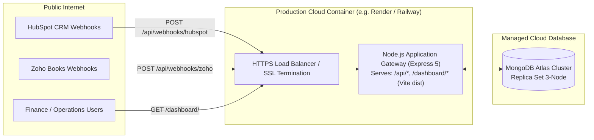

# Production Deployment Guide

This guide details the deployment architecture, configuration steps, and environment setup required to run the CRM & Zoho Books Integration Gateway in a production environment (such as Render, Railway, AWS ECS, or DigitalOcean App Platform).

---

## 1. Production Architecture Topology



---

## 2. Environment Variables Configuration

Create a production `.env` (or set environment variables in your cloud provider's dashboard). **Never commit real values into git.**

| Variable Name | Required | Example / Format | Purpose |
| :--- | :---: | :--- | :--- |
| `PORT` | Yes | `5000` | Port for Express API and static frontend serving |
| `NODE_ENV` | Yes | `production` | Enables Express caching, security optimizations |
| `MONGODB_URI` | Yes | `mongodb+srv://<user>:<pwd>@cluster.mongodb.net/crm_zoho?retryWrites=true&w=majority` | Connection string for MongoDB Atlas cluster |
| `HUBSPOT_ACCESS_TOKEN` | Yes | `pat-na1-...` | HubSpot Private App Token or OAuth access token |
| `ZOHO_CLIENT_ID` | Yes | `1000.XXXX...` | Zoho Books API Client ID from Zoho Developer Console |
| `ZOHO_CLIENT_SECRET` | Yes | `yyyy...` | Zoho Books API Client Secret |
| `ZOHO_REFRESH_TOKEN` | Yes | `1000.zzzz...` | Permanent OAuth 2.0 refresh token |
| `ZOHO_ORG_ID` | Yes | `60093852869` | Zoho Books Organization ID |
| `ZOHO_REGION` | Yes | `in` (or `com`, `eu`) | Regional domain (`in` for accounts.zoho.in) |
| `ZOHO_WEBHOOK_SECRET` | Yes | `sec_hex32...` | Secret token to authenticate incoming Zoho webhooks |
| `OPERATOR_API_KEY` | Yes | `your_secure_operator_api_key_hash` | Bearer/header key required for Dashboard operator actions (fails closed if unconfigured) |
| `DEFAULT_CURRENCY` | No | `AED` | Default currency for sales orders & invoices |

---

## 3. MongoDB Atlas Configuration

1. **Cluster Creation**: Create an M0 (Free Tier) or M10+ dedicated cluster in your target region (e.g., AWS `me-south-1` for UAE or `ap-south-1` for India).
2. **Network Access**: Add your application host IP to the IP Access List (or configure `0.0.0.0/0` with strict database username/password authentication).
3. **Database User**: Create a dedicated service user with `readWrite` role on the target database (e.g., `crm_zoho`).
4. **Connection String**: Use the standard SRV connection string:
   ```text
   mongodb+srv://<username>:<password>@<cluster-address>/<dbname>?retryWrites=true&w=majority
   ```
5. **Schema Indexes**: Indexes are created automatically by Mongoose models on application bootstrap.

---

## 4. OAuth Redirect & Webhook URLs

### HubSpot Webhooks
- In the HubSpot Developer Portal / App Settings:
  - **Target URL**: `https://your-domain.com/api/webhooks/hubspot`
  - **Subscriptions**:
    - `deal.propertyChange` (`dealstage`, `confirmed_go_live_date`)

### Zoho Books Webhooks
- In Zoho Books Settings → Webhooks:
  - **URL to notify**: `https://your-domain.com/api/webhooks/zoho`
  - **Custom Headers**:
    - `X-Zoho-Webhook-Token`: Match the value configured in `ZOHO_WEBHOOK_SECRET`.
  - **Events**:
    - `Customer Payments: Created, Updated, Deleted`
    - `Invoices: Sent, Voided`

---

## 5. Build & Deployment Steps

### Step 1: Build the Vite Frontend
Run the production build script in the root directory:
```bash
npm run build
```
This executes `vite build` within `client/`, compiling assets to `client/dist/` with:
- Minified, tree-shaken JavaScript bundle (`client/dist/assets/index-[hash].js`)
- Precompiled, purged Tailwind CSS (`client/dist/assets/index-[hash].css`)
- `client/dist/index.html` configured for `/dashboard/` base path.

### Step 2: Start the Production Server
```bash
npm start
```
- Express starts on the port specified by `PORT` (defaults to 5000).
- Express automatically serves `client/dist` statically at `/dashboard/`.
- Deep links and client routing are handled cleanly via `/^\/dashboard(\/.*)?$/`.

### Production URLs:
- **API Health Check**: `https://your-domain.com/api/health`
- **Dashboard UI**: `https://your-domain.com/dashboard/`
- **Root Info**: `https://your-domain.com/`

