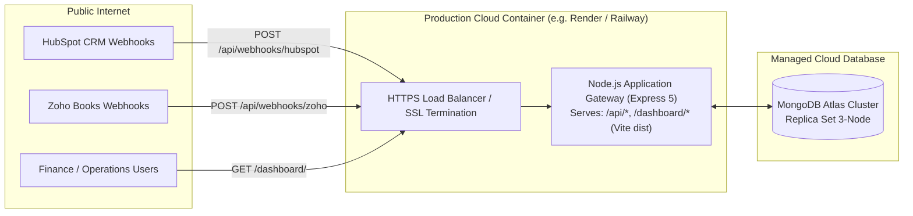

# Production Deployment Guide

This guide details the deployment architecture, configuration steps, and environment setup required to run the CRM & Zoho Books Integration Gateway in a production environment (such as Render, Railway, AWS ECS, or DigitalOcean App Platform).

---

## 1. Production Architecture Topology



---

## 2. Environment Variables Configuration

Create a production `.env` (or set environment variables in your cloud provider's dashboard). **Never commit real values into git.**

| Variable Name | Required | Example / Format | Purpose |
| :--- | :---: | :--- | :--- |
| `PORT` | Yes | `5000` | Port for Express API and static frontend serving |
| `NODE_ENV` | Yes | `production` | Enables Express caching, security optimizations |
| `TRUST_PROXY` | Recommended | `1` (or `2`, `loopback`, `false`) | Reverse-proxy trust setting: `1` for single load balancer (AWS ALB/Render/Railway), `2` for Cloudflare + ALB. Fails safe to `false` if omitted in production. |
| `MONGODB_URI` | Yes | `mongodb+srv://<user>:<pwd>@cluster.mongodb.net/crm_zoho?retryWrites=true&w=majority` | Connection string for MongoDB Atlas cluster |
| `HUBSPOT_ACCESS_TOKEN` | Yes | `pat-na1-...` | HubSpot Private App Token or OAuth access token |
| `ZOHO_CLIENT_ID` | Yes | `1000.XXXX...` | Zoho Books API Client ID from Zoho Developer Console |
| `ZOHO_CLIENT_SECRET` | Yes | `yyyy...` | Zoho Books API Client Secret |
| `ZOHO_REFRESH_TOKEN` | Yes | `1000.zzzz...` | Permanent OAuth 2.0 refresh token |
| `ZOHO_ORG_ID` | Yes | `60093852869` | Zoho Books Organization ID |
| `ZOHO_REGION` | Yes | `in` (or `com`, `eu`) | Regional domain (`in` for accounts.zoho.in) |
| `ZOHO_WEBHOOK_SECRET` | Yes | `sec_hex32...` | Secret token to authenticate incoming Zoho webhooks |
| `OPERATOR_API_KEY` | Yes | `your_secure_operator_api_key_hash` | Bearer/header key required for Dashboard operator actions (fails closed if unconfigured) |
| `DEFAULT_CURRENCY` | No | `AED` | Default currency for sales orders & invoices |

---

## 3. MongoDB Atlas Configuration

1. **Cluster Creation**: Create an M0 (Free Tier) or M10+ dedicated cluster in your target region (e.g., AWS `me-south-1` for UAE or `ap-south-1` for India).
2. **Network Access**: Add your application host IP to the IP Access List (or configure `0.0.0.0/0` with strict database username/password authentication).
3. **Database User**: Create a dedicated service user with `readWrite` role on the target database (e.g., `crm_zoho`).
4. **Connection String**: Use the standard SRV connection string:
   ```text
   mongodb+srv://<username>:<password>@<cluster-address>/<dbname>?retryWrites=true&w=majority
   ```
5. **Schema Indexes**: Indexes are created automatically by Mongoose models on application bootstrap.

---

## 4. OAuth Redirect & Webhook URLs

### HubSpot Webhooks
- In the HubSpot Developer Portal / App Settings:
  - **Target URL**: `https://your-domain.com/api/webhooks/hubspot`
  - **Subscriptions**:
    - `deal.propertyChange` (`dealstage`, `confirmed_go_live_date`)

### Zoho Books Webhooks
- In Zoho Books Settings → Webhooks:
  - **URL to notify**: `https://your-domain.com/api/webhooks/zoho`
  - **Custom Headers**:
    - `X-Zoho-Webhook-Token`: Match the value configured in `ZOHO_WEBHOOK_SECRET`.
  - **Events**:
    - `Customer Payments: Created, Updated, Deleted`
    - `Invoices: Sent, Voided`

---

## 5. Build & Deployment Steps

### Step 1: Build the Vite Frontend
Run the production build script in the root directory:
```bash
npm run build
```
This executes `vite build` within `client/`, compiling assets to `client/dist/` with:
- Minified, tree-shaken JavaScript bundle (`client/dist/assets/index-[hash].js`)
- Precompiled, purged Tailwind CSS (`client/dist/assets/index-[hash].css`)
- `client/dist/index.html` configured for `/dashboard/` base path.

### Step 2: Start the Production Server
```bash
npm start
```
- Express starts on the port specified by `PORT` (defaults to 5000).
- Express automatically serves `client/dist` statically at `/dashboard/`.
- Deep links and client routing are handled cleanly via `/^\/dashboard(\/.*)?$/`.

### Production URLs:
- **API Health Check**: `https://your-domain.com/api/health`
- **Dashboard UI**: `https://your-domain.com/dashboard/`
- **Root Info**: `https://your-domain.com/`

---

## 6. Background Queue Worker Configuration & Execution

The system uses an asynchronous, decoupled queue worker architecture (`server/src/worker.js`) to process webhook events from MongoDB Atlas with lease-based locking, stale recovery, and strict safety guards.

### Worker Environment Configuration
| Variable Name | Default | Purpose / Safety Rule |
| :--- | :---: | :--- |
| `WORKER_ENABLED` | `false` | Must be explicitly `true` to run. Exits safely if unset or false. |
| `WORKER_REQUIRE_ALLOWLIST` | `false` | When `true`, worker refuses to start unless an explicit allowlist is provided. |
| `WORKER_ALLOWED_EVENT_IDS` | *none* | Comma-delimited list of synthetic event IDs permitted for processing. |
| `WORKER_IGNORE_EVENT_IDS` | `hs_manual_test_01` | Comma-delimited list of event IDs permanently excluded from worker execution. |
| `VAT_PERCENTAGE` | `5.0` | Configurable VAT rate. Set to `0` for 0% VAT testing. |

### Starting the Worker
```bash
npm run worker
```

---

## 7. Controlled Live Testing Guide: NovaTech Deal 360608312029

For the approved controlled test of NovaTech deal (`360608312029`, Amount AED 120,000.00, Stage `qualifiedtobuy`):

### 1. Zero-VAT Configuration
To avoid Indian GST / UAE VAT mismatch errors on organizations without UAE tax registration:
```env
VAT_PERCENTAGE=0
```
- Line items are sent without `tax_id` or `tax_percentage`.
- Sales Order: Subtotal AED 120,000.00, Tax AED 0.00, Gross AED 120,000.00.
- Milestone 1 Invoice: Subtotal AED 60,000.00, Tax AED 0.00, Gross AED 60,000.00.

### 2. Synthetic Event ID Consistency
Both the ingestion payload and the worker allowlist MUST use the consistent event ID:
```text
Event ID: hs_sim_novatech_001
```
Set in `.env` for the worker:
```env
WORKER_ENABLED=true
WORKER_REQUIRE_ALLOWLIST=true
WORKER_ALLOWED_EVENT_IDS=hs_sim_novatech_001
WORKER_IGNORE_EVENT_IDS=hs_manual_test_01
```

### 3. Sales Order-Only Stop Point
If you wish to create and confirm the Zoho Books Sales Order **without** generating Milestone 1 Invoice and **without** patching HubSpot:
Invoke `SalesOrderService.createAndConfirmSalesOrder` directly:
```javascript
const SalesOrderService = require('./server/src/services/salesOrderService');
const CustomerService = require('./server/src/services/customerService');

// 1. Resolve Customer (using verified HubSpot Company & Contact IDs)
const cust = await CustomerService.resolveCustomer({
  hubspotCompanyId: '358741933767',
  hubspotContactId: '581389407948',
  companyName: 'NovaTech',
  contactName: 'Arjun Mehta',
  contactEmail: 'arjun.mehta@novatech.com',
  crmDealId: '360608312029'
});

// 2. Create & Confirm Sales Order Only (Tax: 0%)
const soResult = await SalesOrderService.createAndConfirmSalesOrder({
  crmDealId: '360608312029',
  zohoContactId: cust.zohoContactId,
  dealName: 'MANUAL_TEST_001_NovaTech',
  amount: 120000.00,
  currencyCode: 'AED',
  taxPercentage: 0
});

console.log('Confirmed Sales Order:', soResult.zohoSalesOrderId);
// Stop execution here. No invoice is created, and no HubSpot deal properties are patched.
```


