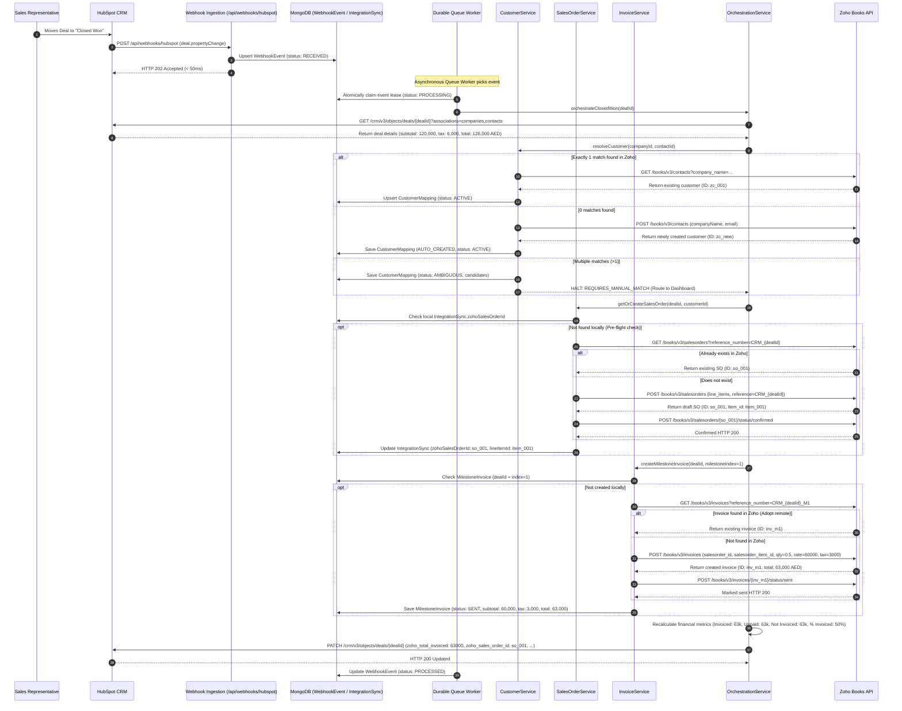
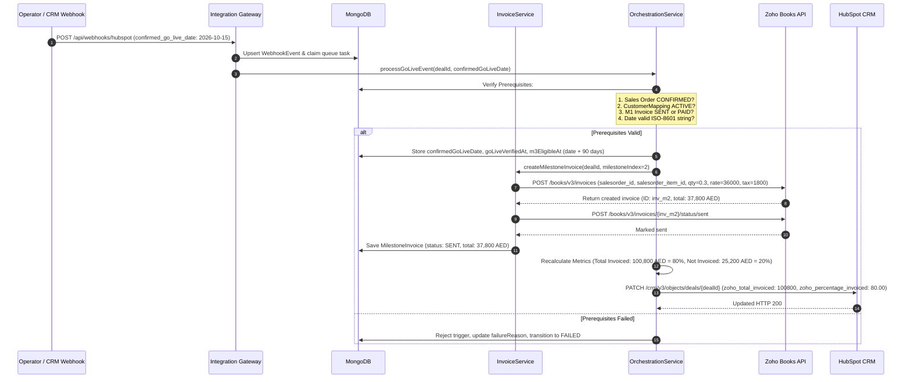
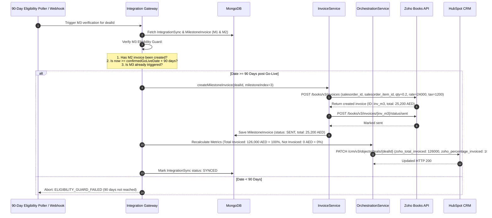
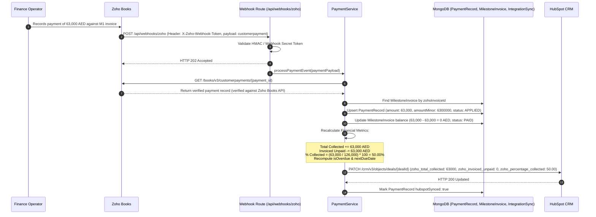
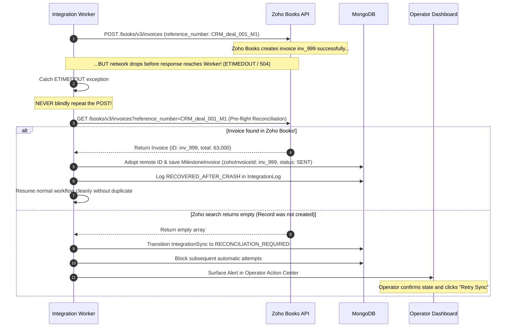

# Integration Sequence Diagrams

This document contains Mermaid sequence diagrams illustrating end-to-end integration workflows, idempotency verification, and crash recovery procedures.

---

## 1. Closed Won to Customer, Sales Order, and M1 Invoice

This flow executes when a deal in HubSpot transitions to `Closed Won`. It creates or maps the customer, creates and confirms a Sales Order, and issues the Milestone 1 invoice (50% on signing).

---

## 2. Go-Live Event Triggering Milestone 2 (30% at Go-Live)

Milestone 2 is **strictly forbidden on Closed Won**. It is triggered only by a genuine, verified go-live event.

---

## 3. 90-Day Post Go-Live Triggering Milestone 3 (20% at 90 Days)

Milestone 3 is permitted only when **confirmedGoLiveDate + 90 days** has elapsed.

---

## 4. Zoho Customer Payment Reverse Sync & Refund Flow

When a finance operator records a payment, partial payment, reversal, or refund in Zoho Books, the integration captures the event and reflects the new financial balance in HubSpot.

---

## 5. Network Drop Crash Recovery & Pre-Flight Reconciliation

This sequence demonstrates what occurs when an HTTP timeout or network drop occurs during a remote invoice creation POST.

